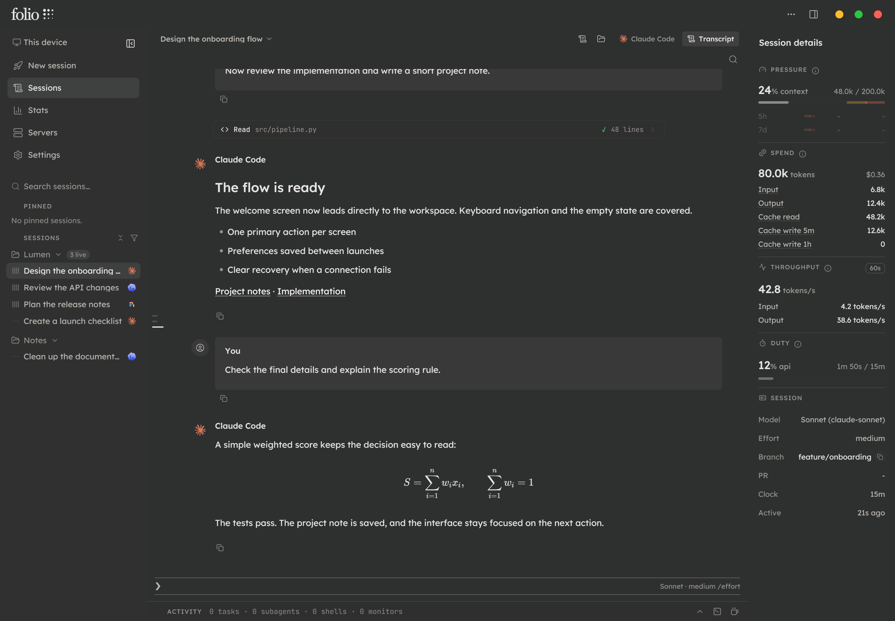
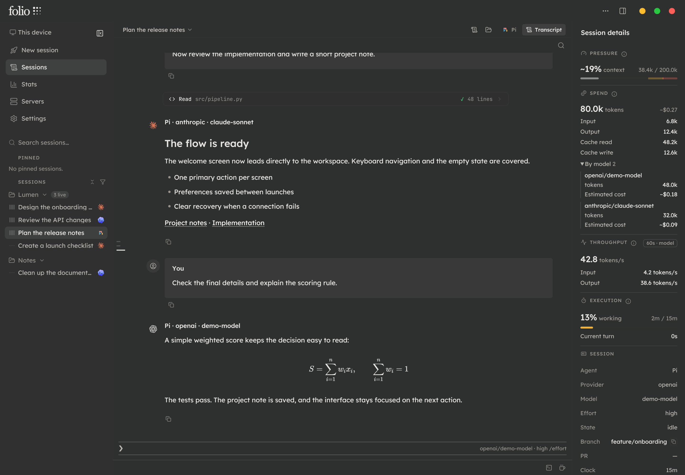
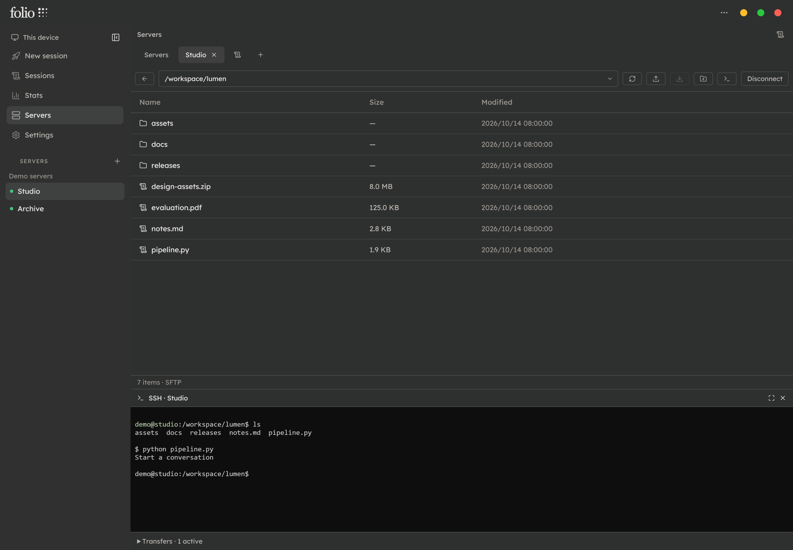
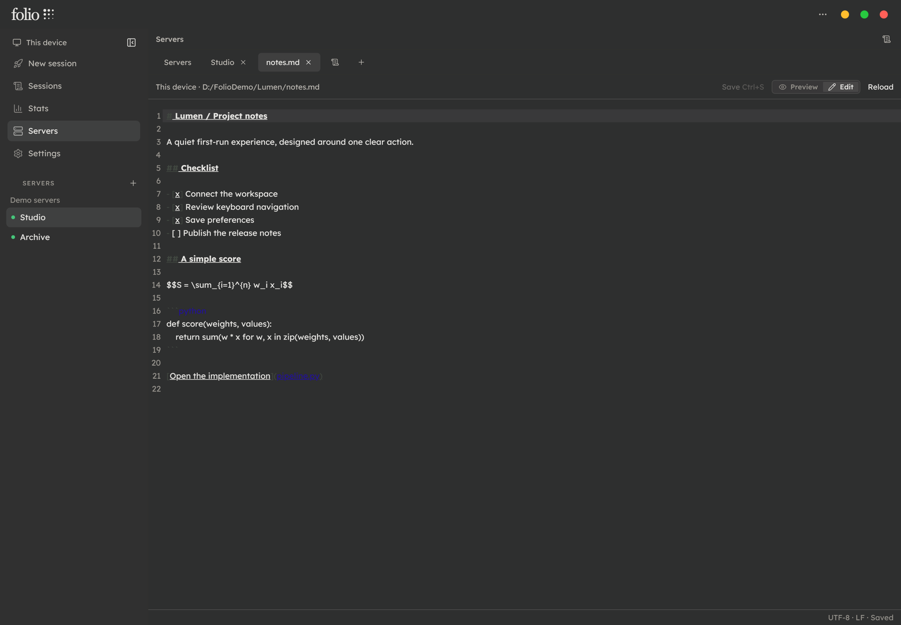
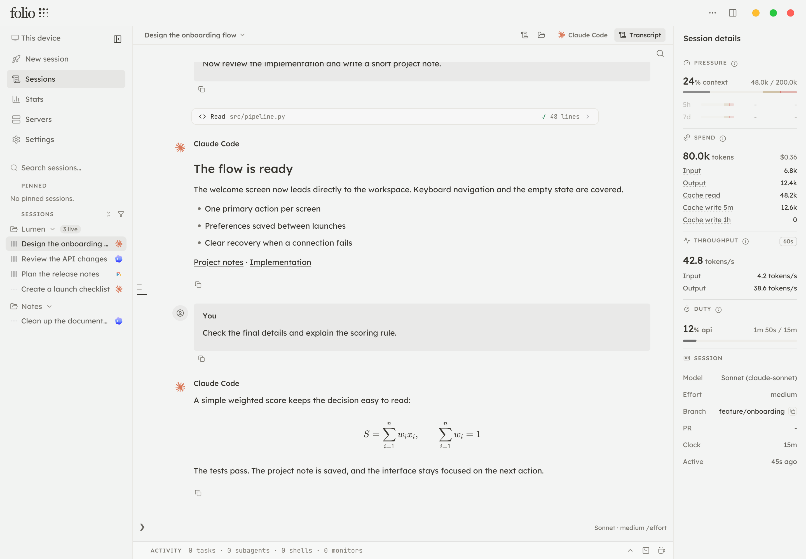

<div align="center">
  
  <h1>folio</h1>
  <p><strong>让 AI 对话、文件与服务器，在同一个工作台里接着工作。</strong></p>
  <p>Claude Code · Codex · Pi · 远程工作区 · 服务器与 SSH · 轻量 IDE</p>
  <p>
    <a href="https://github.com/Shoewashingmachine/Folio/releases">下载与版本说明</a> ·
    <a href="#快速开始">快速开始</a> ·
    <a href="#从源码运行">从源码运行</a> ·
    <a href="#致谢与许可证">致谢与许可证</a>
  </p>
</div>



## 为什么做 Folio

AI 工具越来越多，工作现场却常常分散在不同地方：讨论在对话窗口里，生成的文件需要另开编辑器，服务器文件与 SSH 分别管理；换台电脑，还要重新找回记录与上下文。

Folio 把这些高频操作接进同一个桌面工作台，让讨论、阅读、修改、传输与检查能够连续进行。

Folio 基于开源项目 [Code-by-wire](https://github.com/luojiahai/code-by-wire) 扩展。保留原作的会话管理、原生 CLI、Transcript 与统计基础，继续加入 Pi、远程工作区、服务器连接、轻量文件编辑，以及新的界面与材质设计。它是独立衍生项目。

## 核心功能

### 多 Agent，在一个入口管理

- 集成 **Claude Code、Codex 与 Pi**，按项目浏览和搜索会话。
- 保留原生 CLI，并提供便于阅读的 Transcript，展示消息、工具调用、代码与公式。
- 侧栏筛选与 Settings 中的 Agent 显示设置保持同步。
- Pi 可按自身配置在同一会话中切换厂商与模型，界面区分回复归属、当前模型与各模型用量。
- 上下文、token、速度和费用等指标按各 Agent 可提供的数据展示；估算值明确标示。

> Folio 使用已安装的 Agent CLI 与其账号配置。模型能力、可选厂商和账户权限由对应 CLI、服务商及配置决定；不同 Agent 的原生会话并不因此自动互通。



### 换一台电脑，继续主机上的工作

- 在另一台电脑的主程序中连接自己的主机工作区，继续访问会话、Transcript、CLI 与相关文件。
- 两端同步显示，AI 执行和原始会话记录留在主机。
- 通过本机 **Tailscale、HTTPS 与连接令牌**访问主机；主机需要保持运行并允许访问。
- 远程访问与本机的外观、剪贴板、服务器连接等功能保持明确的数据边界。

这里的“同步”是访问同一个主机工作区，不是把两台电脑的独立离线数据库自动合并。

### 服务器文件管理与内置 SSH

- 保存和分组管理服务器，双击连接，使用标签切换已打开的服务器。
- 支持 **SFTP / SCP** 文件传输和内置 **SSH 终端**。
- 浏览目录、编辑路径、展开路径树、刷新、新建文件和文件夹、重命名、下载与删除。
- 支持 Ctrl / Shift 多选、右键菜单及复制、剪切、粘贴等常用操作。
- 本地文件拖入上传，服务器文件拖出下载；支持同服务器目录移动。
- 服务器档案与凭据在当前设备保存，不通过远程工作区共享。



首次连接或服务器指纹变化时，需要核实主机指纹。SCP 模式的目录浏览和文件管理依赖服务器提供兼容的命令环境；不同服务器的能力与权限可能不同。

### 内置轻量 IDE，打开结果就能继续处理

本地、服务器或 AI 项目中的文件，直接打开为工作台中的标签页。

| 文件类型 | 当前能力 |
| --- | --- |
| Markdown | 在 **Preview / Edit** 之间切换，阅读渲染结果或编辑源码，切换时保留草稿 |
| Python | 直接查看、编辑和保存，不增加额外的预览切换 |
| PDF | 在内置查看器中阅读、翻页与缩放 |
| 其他支持的文本文件 | 根据文件类型、编码与大小进行查看或编辑 |

- 手动保存或使用 **Ctrl + S**，写回文件原位置。
- 服务器文件保存通过连接写回服务器，远程 AI 项目文件保存回主机，本地文件保存到本地。
- 较大文件采用相应限制或分页只读方式，避免一次性加载影响界面响应。



内置 IDE 定位为轻量阅读、编辑与保存，不包含 Python 运行环境、完整调试器或 PDF 内容编辑功能。

### 通透材质与无边框设计

新的无边框窗口搭配 **Mica Alt 材质与可调透明度**，让工作空间轻盈融入桌面，内容仍然清楚可读。

- 提供深色与浅色界面。
- 左侧栏可收起，并通过边缘悬停临时呼出。
- 文件标签、对话和相关状态在同一个工作台中衔接。
- Agent CLI、CLI 弹窗与 SSH 使用独立的不透明终端主题，兼顾命令、菜单和权限提示的可读性。
- 部分界面读取与布局测量会随页面可见性调整，并响应系统的“减少动态效果”设置。

| 深色 | 浅色 |
| --- | --- |
|  |  |

材质与窗口效果取决于 Windows 版本、系统设置和壁纸。截图使用英文界面及虚构演示内容。

## 快速开始

### 1. 获取软件

前往本仓库的 [Releases](https://github.com/Shoewashingmachine/Folio/releases)，下载对应版本的程序和说明。

当前以 **Windows x64** 为主要使用与验证环境。便携包需要完整解压后运行其中的 `Folio.exe`，保留程序旁的资源文件，不能只复制单独的可执行文件。其他平台以本仓库实际发布和验证的构建为准。

### 2. 配置 AI Agent

按需安装并登录 Claude Code、Codex 或 Pi。打开 Folio，在 **Settings → System** 检查相应 CLI 的可用状态，再从 **Sessions** 浏览已有会话，或通过 **New session** 开始工作。

Folio 不包含模型订阅或 API 额度，也不要求同时配置所有 Agent。

### 3. 连接自己的服务器

进入 **Servers**，新建连接，填写地址、端口、协议与认证方式。核实主机指纹后连接，即可管理文件或打开 SSH。

保存服务器信息和远程 AI 工作区连接是两套独立配置；一台电脑保存的服务器档案不会自动传到另一台电脑。

### 4. 配置远程工作区（可选）

1. 两台电脑安装并登录 Tailscale，确保网络访问策略允许连接。
2. 在主机的 **Settings → System** 中启用主机服务与 Tailscale；必要时完成 Tailscale 的 HTTPS / Serve 授权。
3. 在另一台电脑中输入主机 HTTPS 地址与连接令牌，连接主机工作区。
4. 主机保持运行；断开远程后可返回本机工作区。

## 数据与隐私

- **本机会话**：通过相应 Agent 的本地记录与进程提供功能。模型请求仍由所选 Agent 发送至对应服务商。
- **远程工作区**：记录与执行留在自己的主机；客户端保存必要的连接设置、界面偏好与未发送草稿，主动下载文件时才写入本地目标位置。Folio 不提供会话云托管。
- **Tailscale**：使用其加密网络连接设备；网络条件需要时，可能通过中继转发加密流量。不能将其理解为完全不接触第三方服务。
- **服务器档案与凭据**：通过本机加密存储保存，不通过远程工作区接口共享。复制软件到其他电脑时，不要同时复制用户数据、凭据保险库或 SSH 私钥。

## 从源码运行

需要 **Node.js 24+**，使用项目指定的 **pnpm**（当前为 `11.5.3`）。在源码仓库根目录执行：

```sh
pnpm install
pnpm rebuild:native
pnpm dev
```

`better-sqlite3` 与 `node-pty` 是原生模块。安装依赖或升级 Electron 后，需要针对 Electron 的 ABI 重新构建。

开发检查：

```sh
pnpm typecheck
pnpm test
pnpm lint
```

项目使用 Electron、React、TypeScript、xterm.js、CodeMirror、PDF.js 与 ssh2 等组件。打包行为以仓库中的构建配置与发布说明为准。

## 反馈

通过本仓库的 [Issues](https://github.com/Shoewashingmachine/Folio/issues) 提交问题或功能建议。报告问题时，请附系统与版本、相关 Agent、复现步骤和脱敏截图；不要提交密码、API Key、连接令牌、SSH 私钥或个人对话记录。

## 致谢与许可证

Folio 基于 [Code-by-wire](https://github.com/luojiahai/code-by-wire) 扩展，感谢原作者 **[luojiahai](https://github.com/luojiahai)**（小红书：肆海）及原项目贡献者。会话管理、CLI、Transcript 与统计等基础能力来自原作。

Folio 是独立衍生项目，功能、界面和发布由本仓库维护，不代表原作者或各模型厂商的官方产品。

项目沿用 [MIT License](LICENSE)，保留原项目的版权与许可声明。第三方组件和品牌分别遵循各自的许可及使用要求。
